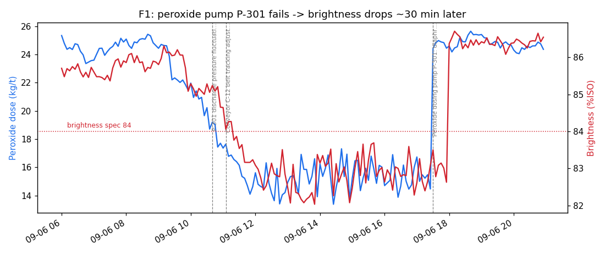

# Agentic Root-Cause Analysis Assistant

A multi-agent system that investigates quality incidents in a (simulated) paper mill the way a
senior process engineer would: it queries process data, runs RCA analytics (anomaly detection,
batch comparison, lagged cross-correlation, event correlation), retrieves SOPs and past incidents,
and writes an evidence-backed root-cause report.

> Work in progress — built in phases. See the roadmap below.

## Roadmap
- [x] Phase 1 — Synthetic plant data with 6 injected faults and hidden ground truth
- [x] Phase 2 — RCA analytics toolkit (anomalies, batch comparison, lagged cross-correlation, event correlation)
- [x] Phase 3 — RAG knowledge base: 7 SOPs + 9 past incidents, hybrid BM25 + embeddings with RRF
- [x] Phase 4 — Agents + LangGraph orchestration: planner, tool-calling data analyst, retrieval, report writer
- [ ] Phase 5 — Guardrails + critic loop
- [ ] Phase 6 — Evaluation harness
- [ ] Phase 7 — MCP server, API, Docker

## Quick start
```bash
pip install -r requirements.txt
python -m rca.simulation      # creates data/plant.db and eval/ground_truth.json
pytest -q                     # 19 tests, no API key needed
```

### Run an investigation
1. Get a free API key at [console.groq.com](https://console.groq.com) and put it in `.env`
   (see `.env.example`). OpenAI also works (`LLM_PROVIDER=openai`).
2. Ask a question:
```bash
python -m rca.cli "Why did batch B-1034 fail the brightness spec?"
```
Retrieval uses local embeddings (`fastembed`, no key needed; the model downloads on first run)
plus BM25. Tests use a scripted fake LLM, so `pytest` never needs an API key.

## Architecture
```
question -> Planner -> +-> Data Analyst (tool calling) -+-> RCA Writer -> report
                       +-> Knowledge (hybrid RAG) ------+
```
| Node | Role | LLM? |
|---|---|---|
| Planner | Extracts batch id, symptom and hypotheses; batch facts come from the DB | yes (structured output) |
| Data Analyst | Calls the RCA toolkit (anomalies, batch comparison, lagged correlation, events, read-only SQL) | yes (tool calling) |
| Knowledge | Searches SOPs and past incidents for the symptom and every hypothesis | no |
| RCA Writer | Evidence-backed report validated against a Pydantic schema | yes (structured output) |

## The simulated plant
30 days of one paper machine (5-minute readings, 4-hour batches, 180 batches) with six injected faults:

| # | Fault | Why it is in the test set |
|---|---|---|
| F1 | Peroxide pump diaphragm tears | Cause → effect with a 30-min lag, plus a red-herring maintenance event |
| F2 | Steam valve leak lowers bleach temperature | Same symptom as F1, different cause |
| F3 | pH probe drifts high | Alarms fire but quality is fine — a sensor fault, not a process fault |
| F4 | Press felt left past its planned life | Gradual degradation, not a step change |
| F5 | New pulp supplier lot | No sensor deviates — only event correlation finds it |
| F6 | Disc filter screens blind | Environmental (effluent TSS) failure |

The true root causes live in `eval/ground_truth.json`, never in the database, so the agent cannot
look up the answers.


